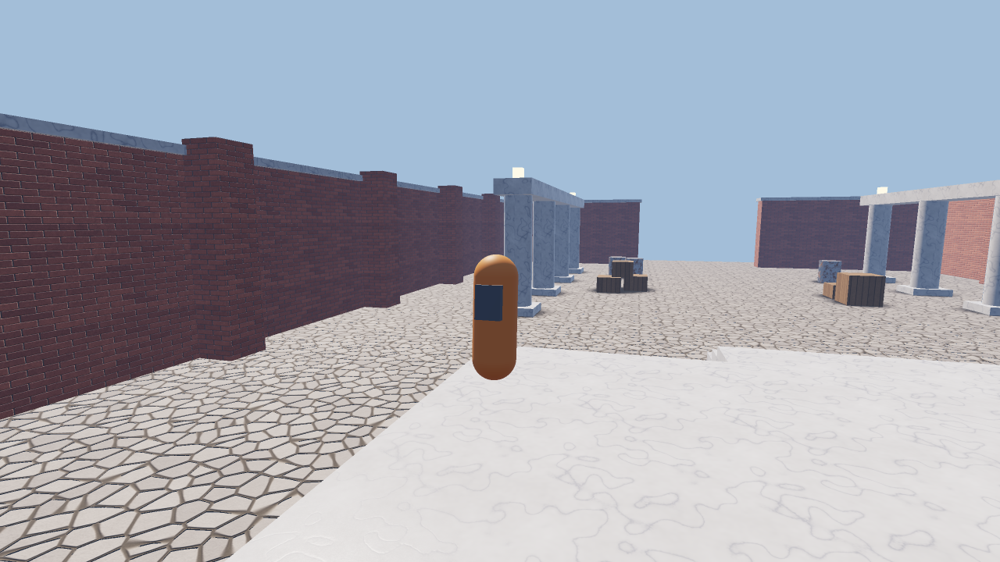
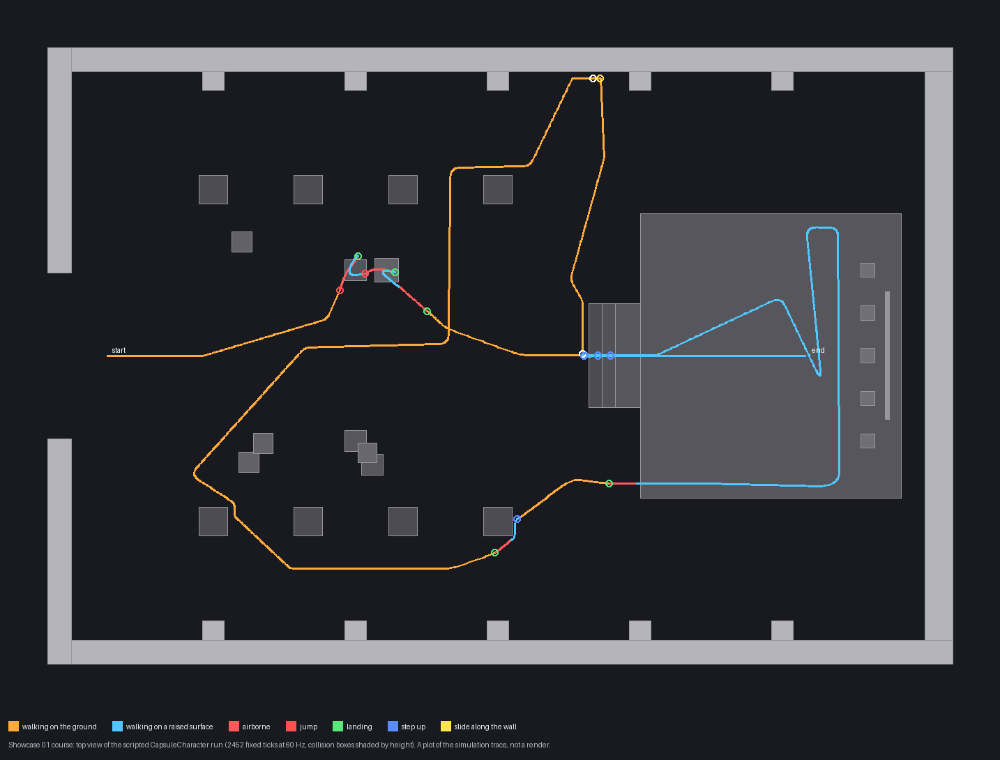

# SAIGE Showcase 01: Courtyard captures

Real frames from SAIGE's own Vulkan renderer, produced in a cloud container with no GPU. **Every image and video here was rendered by Mesa
lavapipe, a CPU software rasterizer** (`evidence_class: software_vulkan_cpu_rasterizer` in the `report-*.json` files). They demonstrate what the
engine draws and how the character collides. They say nothing about physical-GPU speed, and no 60 FPS claim is made or implied.

Source: branch [`claude/showcase-01`](https://github.com/devincombs2007-rgb/SAIGE/tree/claude/showcase-01), `showcase/01-courtyard` and
[`docs/showcase/01-courtyard.md`](https://github.com/devincombs2007-rgb/SAIGE/blob/claude/showcase-01/docs/showcase/01-courtyard.md).
Built from commit `9582608` (the later `4964b22` only adds CMake warning flags, the workflow and docs). Device: llvmpipe (LLVM 20.1.2), Vulkan 1.4 reported, 8 stills at 1920x1080
(2x supersampled), video at 1280x720 (2x supersampled), 30 fps, 2452 fixed ticks (40.9 s) of a scripted CapsuleCharacter run. Course state hash `2c43234df28b2279` (deterministic).

## The run (software-Vulkan render)

- [showcase-01-run-480p.mp4](showcase-01-run-480p.mp4) (5.8 MB, 854x480, best on a phone) · [showcase-01-run.mp4](showcase-01-run.mp4) (30 MB, 1280x720) · [first 16 s as a GIF](showcase-01-first-16s.gif)
- 45 s: a fly-over that hands over to a chase camera. The character walks, sprints, jumps onto a 0.5 m and a 1 m crate, climbs three marble steps, steps off the dais, runs into the north wall and slides along it, and ends in front of the material row.

## Stills (software-Vulkan render, 1920x1080)

[contact sheet](contact-sheet.jpg) · [01 establishing](stills/01_establishing.png) · [02 colonnade](stills/02_colonnade.png) · [03 crate jump](stills/03_crate_jump.png) · [04 marble steps](stills/04_marble_steps.png) · [05 material row](stills/05_material_row.png) · [06 glass and lanterns](stills/06_glass_and_lanterns.png) · [07 barrels](stills/07_barrels.png) · [08 overview](stills/08_overview.png)

## Movement and collision (plot of the simulation trace, not a render)

Orange: walking on the ground. Light blue: walking on a raised surface (steps, dais, crate tops). Red: airborne. The path bends around columns, barrels and crates and
follows the north wall during the slide. `trace.json` holds every tick (position, velocity, grounded, waypoint) and every event.

## What you are not seeing

No real shadows (the dark patches under objects are placed blob decals) and no image-based lighting, so metals look dull. No character animation (a rigid capsule with a speed lean). The run is scripted and offscreen, not
interactive. Windows and physical-GPU results are not part of this set. The renderer's per-frame time in `perf-video.json` (about 160 ms for a 2560x1440 internal frame) is the CPU rasterizer and not a statement about any GPU.
