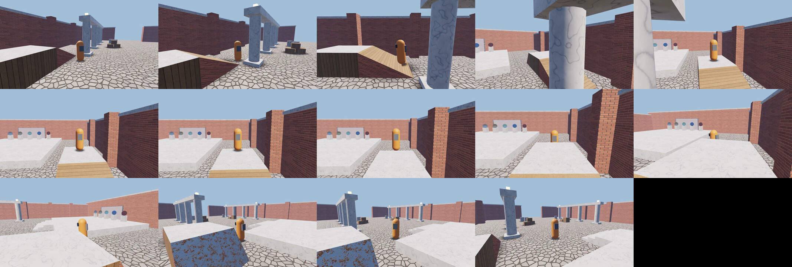
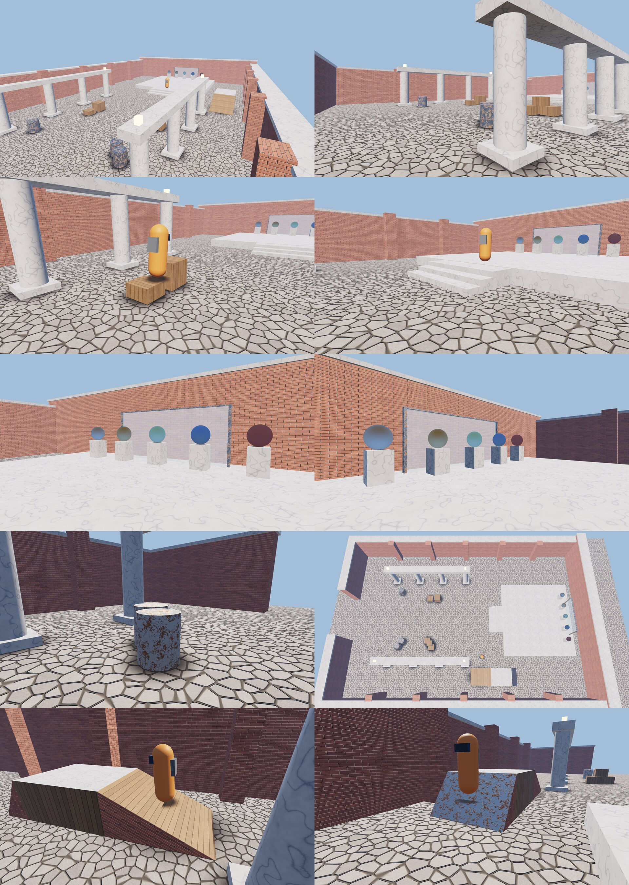

# SAIGE Showcase 01: Courtyard captures (with the new ramp plaza)

Real frames from SAIGE's own Vulkan renderer, produced in a cloud container with no GPU. **Every image and video here was rendered by Mesa
lavapipe, a CPU software rasterizer** (`evidence_class: software_vulkan_cpu_rasterizer` in the `report-*.json` files). They show what the
engine draws and how the character collides. They say nothing about physical-GPU speed, and no 60 FPS claim is made or implied.

Source: branch [`claude/showcase-01`](https://github.com/devincombs2007-rgb/SAIGE/tree/claude/showcase-01) (draft PR #72), commit
[`6c0751e`](https://github.com/devincombs2007-rgb/SAIGE/commit/6c0751e) (the docs commit after it changes no code), `showcase/01-courtyard` and
[`docs/showcase/01-courtyard.md`](https://github.com/devincombs2007-rgb/SAIGE/blob/claude/showcase-01/docs/showcase/01-courtyard.md).
Device: llvmpipe (LLVM 20.1.2). 10 stills at 1920x1080 (2x supersampled); video 1280x720 (2x supersampled), 30 fps, 50 s; 2780 fixed ticks (46.3 s) of a
scripted `CapsuleCharacter` run, state hash `f4da7413e1d69b22` (deterministic).

## The engine feature shown: collision against triangles (ramps and slopes)

Until now the capsule controller only collided with boxes. The new ramp plaza near the south wall is **triangle collision**: a capsule swept exactly against
two-sided triangles ([PR #73](https://github.com/devincombs2007-rgb/SAIGE/pull/73), commit [`4ffa520`](https://github.com/devincombs2007-rgb/SAIGE/commit/4ffa520)) and the
controller's slope, step and slide rules running on the triangles' contact normals ([PR #74](https://github.com/devincombs2007-rgb/SAIGE/pull/74), commit
[`a7fdc28`](https://github.com/devincombs2007-rgb/SAIGE/commit/a7fdc28)). In the run the character

1. walks up a **25 degree wooden ramp** staying grounded the whole way (ground normal z = 0.906 = cos 25 in `trace.json`) onto a 1.4 m platform,
2. crosses the platform, and creeps off the crest onto a **54 degree chute**, which is steeper than the 50 degree walkable limit, so it cannot stand there: it drops briefly, lands on the chute and **slides down** it to the floor.

Engine bug found on the way: an idle character on a slope too steep to stand on was braked by the air-control code and crept down at ~0.1 m/s instead of accelerating; fixed in #74 with a test.

## The run (software-Vulkan render)

- Phone-friendly: [showcase-01-ramp-clip-480p.mp4](showcase-01-ramp-clip-480p.mp4) (9 s, 1.5 MB: the ramp, platform and chute) · [showcase-01-run-480p.mp4](showcase-01-run-480p.mp4) (50 s, 6 MB)
- Full quality: [showcase-01-run.mp4](showcase-01-run.mp4) (1280x720, 33 MB) · [first 16 s as a GIF](showcase-01-first-16s.gif)

Frames from the ramp clip (every 0.67 s, taken from the video):

## Stills (software-Vulkan render, 1920x1080)

[contact sheet](contact-sheet.jpg) · [01 establishing](stills/01_establishing.png) · [02 colonnade](stills/02_colonnade.png) · [03 crate jump](stills/03_crate_jump.png) · [04 marble steps](stills/04_marble_steps.png) · [05 material row](stills/05_material_row.png) · [06 glass and lanterns](stills/06_glass_and_lanterns.png) · [07 barrels](stills/07_barrels.png) · [08 overview](stills/08_overview.png) · **[09 ramp climb](stills/09_ramp_climb.png)** · **[10 chute slide](stills/10_chute_slide.png)**

## Movement and collision (plot of the simulation trace, not a render)

Orange: walking on the ground. Light blue: walking on a raised surface (steps, dais, crate tops, ramp, platform). Red: airborne. Teal outlines: the ramp and chute triangles. `trace.json` holds every tick (position, velocity, grounded, waypoint) and every event.

## Evidence

Hosted CI on the engine branches: PR #73 and PR #74 each pass all six checks (Linux Debug, Windows Debug and Release, linux-vulkan-lavapipe, linux-gcc-asan, windows-msvc-vulkan). Regression tests: `capsule_triangle` (a triangulated box must match the box sweep; an independent brute-force reference;
mutation-checked) and `capsule_slopes` (walking, standing, sliding, boundary angles, crease and crest, bit-identical replay, 24 random ramp worlds) in those PRs, and `showcase_course` / `showcase_smoke` on the showcase branch.

## What you are not seeing

No real shadows (the dark patches under objects are placed blob decals) and no image-based lighting, so metals look dull. No character animation (a rigid capsule with a speed lean). The run is scripted and offscreen, not interactive. Windows and physical-GPU results are not part of this set. The renderer's per-frame time in `perf-video.json` (about 190 ms for a 2560x1440 internal frame) is the CPU rasterizer and not a statement about any GPU.
