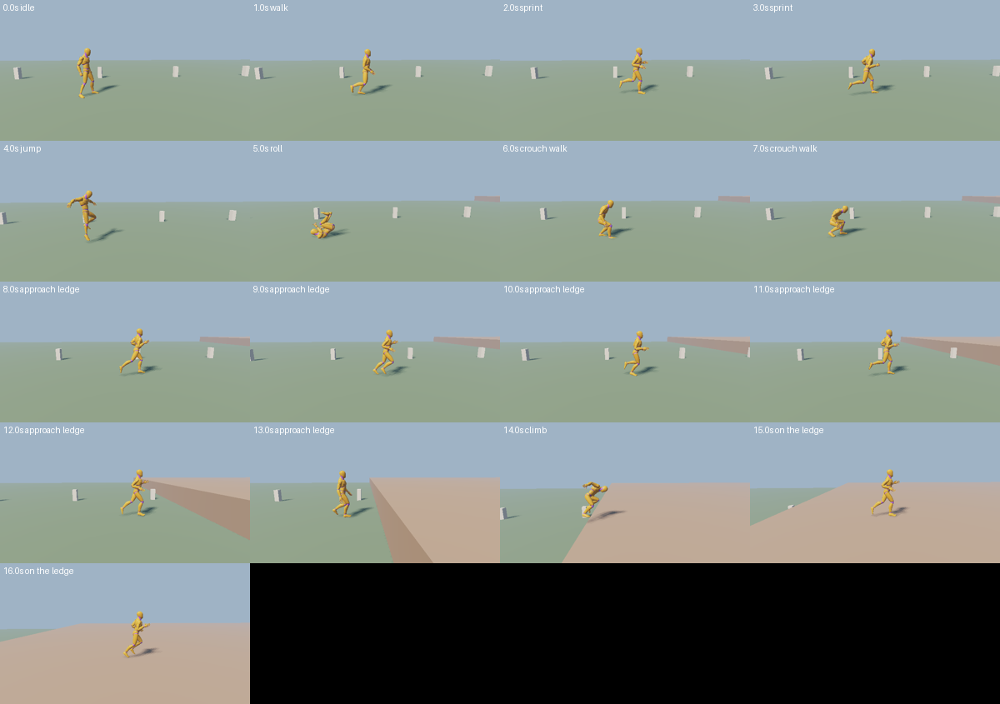

# Character animation (saige::animation)

Reusable humanoid animation on top of the stateless sampling in `engine/gfx_assets/animation.hpp`. Source: `engine/animation`. Runnable example: `saige_anim_character_demo`. Tools: `saige_anim_inspect`, `saige_anim_mocap_probe`.

## Ownership contract (record for Core; proposed on issue #43 because Core is away)

| Concern | Owner | How |
| --- | --- | --- |
| Where the character is: position, velocity, collision, slopes, steps, jumping | the physics controller (`CapsuleCharacter`) | authoritative; animation never moves it |
| Which pose the character has | `LocomotionController` | follows the physics: it is fed the character's **real** horizontal speed, grounded flag and vertical speed each tick (`locomotion_input`), never the input |
| Root motion | the clip is **not** allowed to move the character | locomotion cycles are played in place (`evaluate_in_place` removes the clip's travel); the clip's travel survives only as data (`ClipInfo::root_speed`, `ground_speed`, `stride_length`), which sets the playback rate. Clips that are meant to carry the character (a roll, a lunge) are the explicit **action** mode (`action.hpp`): the clip's own travel is *requested* from the physics (`CapsuleInput::drive`), the capsule decides how far it really gets, and the clip advances only by what was allowed |
| Foot contact with terrain | IK layer (`adapt_feet_to_ground`) | stateless, after the blend; the pelvis follows the ground; call only while grounded |
| Foot contact with walls | IK layer (`keep_feet_outside_obstacles`) | the capsule is narrower than a stride is long; a foot ahead of the capsule is pulled out of the wall |
| GPU skinning | Rendering (gfx_assets, render) | consumes the skin matrices of the final pose |

Why speed from the physics: a character pushing into a wall has speed 0, so its pose returns to the idle instead of running on the spot; a character on a slope or a slowing surface plays slower; a knock-back plays at the speed it really has. `saige_animation_character_tests` checks each of these against a control that animates from the input instead.

Threading and lifetime: a `LocomotionSet` holds a pointer to its `gfx::Skin` (which must outlive it) and is immutable after setup, so many controllers may share one. A controller is single-threaded state. `GroundQuery` and `ObstacleQuery` are `std::function`s; the glue in `capsule_glue.hpp` captures a `StaticCollision` by reference, which must outlive the query. Positions are the collision's chunk-local meters.

## What is in it

* `humanoid.hpp`: `Bone` roles and `map_humanoid`, by name (Rigify `DEF-`, Unreal, Mixamo, CMU all map; case, prefixes, separators and L/R suffixes are ignored; core bones are required). Needs `Skin::joint_names` (new in the glTF importer).
* `pose_ops.hpp`: model-space joint transforms, pose blending, pose distance.
* `clip_analysis.hpp`: measures a locomotion cycle from its poses instead of trusting its name: the **ground speed** (how fast the character must move for planted feet not to slide), stride, when each foot is planted, loop quality, and the rig's facing and proportions. The contact point is the toe joint (an ankle drifts through the heel-to-toe roll), the speed is the median over the interior of the planted run, and the planted window is refined to where the foot moves at that speed.
* `locomotion.hpp`: `LocomotionSet` (cycles sorted by measured speed, idle, jump start, air, land) and `LocomotionController`: states Ground / JumpStart / Air / Land with crossfades; the ground state blends the two cycles around the speed with **stride-matched playback** (cycle rate = speed / blended stride, so the blended planted foot moves at the character's speed) and **one shared phase** aligned on the left-foot landing of every cycle; idle with hysteresis and a fixed-length crossfade.
* `bvh.hpp`: a BVH importer (CMU motion capture) and `extract_loop`, which finds the best repeating stretch of a capture and closes it into a seamless in-place cycle (facing +X, floor and origin normalized).
* `retarget.hpp`: world-orientation retargeting between humanoids of different proportions, rest poses, names and facing; hips translation scaled by the leg-length ratio.
* `ik.hpp`: analytic two-bone IK, ground adaptation (pelvis height, per-leg IK, foot tilt to the surface normal), **hand IK** (`reach_hand`: a hand on a world point, elbow bending backward and slightly outward, optional world grip rotation, weight to fade, out-of-reach extends toward the target), `FootPlacement` (the whole chain behind one call, `apply`: ground adaptation, then foot locking, both only while grounded, then the wall check always; leaving the ground resets the locks and the pelvis offset so a landing starts clean; the queries are optional), foot locking (a planted foot is pinned to where it landed through its stance; the anchor is dragged if the animation drifts more than 15 cm, so the foot never pops) and wall avoidance.
* `action.hpp`: root-motion actions (`ActionClip`, `ActionPlayer`). The clip's hips path is measured once (60 samples a second, in the character's forward/left frame). Each tick the host asks `command(dt)` for the velocity that covers the clip's travel over that step, turns it into `CapsuleInput::drive` (`capsule_drive`, any heading), steps the capsule, measures how much of it the capsule covered (`drive_progress`) and calls `advance(dt, progress)`: the clip moves on by dt times that share. With the `vertical` option a clip's rise is root motion too (a climb: the capsule is driven as a scripted 3D move, `CapsuleDrive::vertical`, with no gravity and full collision, and the pose has the rise removed). A roll into a wall therefore holds at the wall instead of playing on, and ends after 0.4 s without headway (`stalled()`); `cancel()` ends it (the host does that when the capsule leaves the ground). The pose is the clip with the hips' horizontal travel removed *exactly at every time* (a cycle's linear drift removal would leave a roll swimming by decimeters; the tests measure that), the vertical motion kept, and `weight()` is the share to `blend_into` over the locomotion pose. UAL's `Roll_RM` (5.09 m in 1.47 s) and `Sword_Attack_RM` (1.50 m) are measured and played this way.
* `layers.hpp`: **upper-body layering** (`BoneMask`, `upper_body_mask`, `mask_below`, `blend_masked`) lays a clip that drives only part of the body (an aim pose, a carry) over the locomotion pose; the legs, hips and so the feet stay the locomotion's bit for bit. `blend_additive` is the additive form: a layer's change from its reference pose (the clip's first frame or the rest pose) is added on top of whatever the body does, by weight and mask, so a flinch or a breath does not replace the run's own arm swing. **Look-at** (`look_at`, `LookAtConfig`, `LookAtState`) turns spine, chest, neck and head toward a world point by their shares (0.15 / 0.25 / 0.25 / 0.35), within yaw (70 degrees) and pitch (45 up, 35 down) limits, smoothed in time (0.12 s), rotations only, with a weight to fade it; a target behind is looked at over the nearer shoulder to the limit, and the return value says how far the head still is from facing it.
* Crouching: the capsule has a crouched state (`CapsuleInput::crouch`, `CapsuleCharacterState::crouched`, `crouch_height`, `crouch_speed`): the feet stay, the head comes down to the crouch height, the character moves at the crouch speed, cannot sprint or jump, and stands only when the standing capsule fits (it stays crouched under a low ceiling). Animation side: a second `LocomotionSet` for the crouch clips (UAL `Crouch_Idle_Loop`, `Crouch_Fwd_Loop`), a controller each, and `StanceBlend` crossfading their poses by the capsule's `crouched` flag; `crouch_capsule_height` sizes the capsule from the crouch pose's head (UAL: 1.11 m, 66% of 1.7 m, not the 60% default). Set `crouch_speed` near the crouch cycle's own ground speed (UAL 0.73 m/s): the stride match is limited to 1.6 times the authored rate.
* `capsule_glue.hpp`: capsule state to locomotion input, `capsule_drive` / `drive_progress` for actions, ray-cast ground and obstacle queries, and `find_ledge`: from the feet and a heading, the distance to an upright face, the height of the top behind it and the headroom above it (not found for a wall too high, a step too low, a ramp, too little headroom or nothing within reach), so the host can choose a climb (the rise against `ActionClip::travel().up`) and stand the character where the clip expects.

## The viewer: the whole chain on the real renderer

`saige_anim_viewer` (`tools/animation/viewer`) runs a scripted course with the UAL character through the real renderer (HDR, metallic-roughness, skinned draws through a `SkinPalette`, sun shadows) and writes one PPM per captured frame plus `report.json` (device, whether it was a software rasterizer, the script stage of each frame). The script: idle, walk, sprint, a jump from the sprint (take-off, air, landing states), a roll (UAL's `Roll_RM`), a crouch walk (the capsule's crouch, the UAL crouch set and `StanceBlend`), the ledge found with `find_ledge`, the character stood where the climb clip's first foot meets the face, and a 1 m climb (UAL 2's `ClimbUp_1m_RM`, retargeted onto the UAL rig), then a jog on the ledge. Everything is driven by Core's capsule character: the animation follows the physics, actions ask the capsule for their travel and read back how far it got, and `FootPlacement` plants the feet. `python3 tools/animation/viewer/sheet.py OUT_DIR` makes a contact sheet; `docs/images/anim-viewer-sheet.png` is one (software Vulkan, llvmpipe, 640 x 360, every 6th captured frame of a 17 s run).

`SAIGE_ANIM_ASSETS=DIR saige_anim_viewer --out OUT --self-check` renders the run (about 100 frames in a few seconds on the CPU rasterizer) and checks that no frame is empty, that the picture changes, and that the character ends on the 1.00 m ledge; `ctest -R animation_viewer` runs a shorter version and is skipped without the assets or a Vulkan device. This is a visual and integration check on a software rasterizer; it makes no performance claim and is not GPU evidence.

## Assets

| Asset | Use | License | Notes |
| --- | --- | --- | --- |
| Quaternius Universal Animation Library (Standard, Godot): one rig with a mesh, 46 clips | the humanoid rig; idle, walk, sprint, jump clips | CC0 | **keyframed by artists, not motion capture**; the walk runs at 1.05 m/s and the sprint at 8.96 m/s by measurement, with nothing between |
| CMU Graphics Lab motion capture (BVH conversion by B. Hahne) | real human walk, brisk walk and jogging clips, retargeted to the rig; fills the speed range between the UAL's walk and sprint | free for research and commercial use; attribution text requested (in the catalog and `tools/animation/assets.json`) | raw redistribution is not stated, so files are fetched by script and not committed |
| Quaternius UAL 2 (Unreal-style rig, 43 clips: climbing, sliding, dashes, a carry walk; no strafe or turn) | `ClimbUp_1m_RM` for the vertical action test (optional asset: `ual2/` in the asset directory) | CC0 | keyframed by artists; a 1 m climb with 1.68 m of forward and 1.00 m of vertical root motion |
| KayKit Character Animations | cataloged, not used | CC0 | UAL 2 is the same family on an Unreal skeleton (maps with the same code); KayKit's rig has 6 joints and is not humanoid enough for locomotion |

`python3 tools/animation/fetch_humanoid_assets.py DIR` downloads and verifies (SHA-256) the CMU files and copies the UAL file from the asset cache; `SAIGE_ANIM_ASSETS=DIR ctest -R animation_assets` then runs the real-asset test (exit 77 / skipped without it).

## Evidence

Software only; no physical GPU is involved (this is CPU animation).

* Clip analysis against the independent truth: on synthetic gaits with exact foot paths the measured ground speed is exact (1.000 for 1.0, 3.500 for 3.5 m/s); on the CMU captures the foot-based speed agrees with the actor's own travel speed (root travel over the cycle) to within 5%: walks 1.19 / 1.39 / 1.88 m/s, jogs 2.7 to 2.8, runs 3.6 to 4.0 m/s.
* Foot sliding (planted contact points, mean world speed): at the cycles' own speeds under 6 cm/s on synthetic gaits (0.1 to 0.8% of the speed); between two gaits, 0.1 to 0.3 m/s (the blended stance windows only partly overlap); the control without stride matching slides 2.0 m/s beyond the fastest cycle. On the real set (inside the middle 70% of each cycle's stance): the UAL sprint 1.8% of the speed; the retargeted capture cycles 10 to 27% of the speed without foot locking and 0.1 to 4.8% with it (`saige_animation_assets`).
* Transitions: the largest per-tick pose change through a jump is below the fastest gait's own per-tick change; every state sequence (walk, jump, fall, land; walking off a ledge; a hop that lands during the takeoff; standing landing) is checked.
* Collision consistency, with Core's `CapsuleCharacter` on static boxes and triangles: running into a wall, the character stops and returns to idle (idle weight above 0.95) while a control driven by the input keeps running (below 0.05); with wall IK no foot goes more than 5 mm into the wall, without it a running pose leans its feet more than 5 cm into it; on 10 and 20 degree ramps planted feet are within 8 and 24 mm of the surface with ground IK and more than 6 cm off without it; the jump states start within two ticks of the capsule's takeoff and landing.
* Root-motion actions (`test_action.cpp`, `test_character.cpp`, `character_drive_test.cpp`, `assets_test.cpp`): the commanded velocities add up to the clip's travel (within 3 mm of 3.0 m on an ease-in-out profile); the in-place pose stays within 2 mm of the origin while the clip's dip is kept, and the linear-drift control swims by more than 15 cm; on the capsule a 4 m roll covers 4.00 m (within 3 cm) along any of four headings with no sideways drift; rolling toward a wall 1.5 m away the capsule stops at the wall and the clip's claimed travel equals the capsule's (1.50 m, within 6 cm) and ends, while the control that ignores the physics claims 4.00 m with the capsule at 1.50 m; a roll off a ledge is ended when the capsule leaves the ground; the drive is ignored in the air, rejected when non-finite and capped at the terminal speed, and an inactive drive leaves 400 mixed-input ticks bit-identical. Real clips: `Roll_RM` 5.09 m, `Sword_Attack_RM` 1.50 m, in place to 0.0 mm.
* Layering and look-at (`test_layers.cpp`, `assets_test.cpp`): the mask covers the spine and above only; a masked blend leaves nine leg and hip joints bit-identical and gives the arms the layer's pose (half weight, half the rotation); the head faces targets from 0 to 55 degrees of yaw and -25 to 30 of pitch within 1.5 degrees from two different headings, never moves a joint (rotations only), stops at the limits for a target behind or far above, and a jumping target is followed monotonically without overshoot, 63% of the way after one smoothing time. Real UAL rig: `Pistol_Aim_Neutral` over a sprint puts the arms exactly in the aim pose (they were 1.74 rad away) with the legs and hips untouched, and the head faces a target 4 m ahead and 2 m left to within 0.01 degrees.
* Hand IK (`test_ik.cpp`, `assets_test.cpp`): both hands reach targets in four directions from two headings within 2 mm, bones keep their length to 0.1 mm, the elbow bends toward the pole, only the arm's three rotations change, a far target gives a fully extended arm pointing at it, weight 0 is bit-identical, a grip sets the hand's world rotation; on the UAL rig both hands land on a point 0.35 m ahead of the shoulder within 0.01 mm.
* Crouching (`character_crouch_test.cpp`, `test_layers.cpp`, `assets_test.cpp`): crouching lowers the capsule to the crouch height with the feet in place; the crouch speed is half the walking speed with sprint held; no jump while crouched; a standing character stops at a 1.3 m beam while a crouched one walks under it; releasing the key under the beam does not stand up into it, and it stands once clear; a reset character stands; invalid heights and speeds are rejected; without the crouch input the character never crouches. UAL: the crouch walk is a clean cycle (0.73 m/s, planted feet move at 5.0% of the speed), and a stance blend changes the pose by at most 0.179 rad per tick against 0.592 in the fastest gait.
* Vertical actions (`character_drive_test.cpp`, `test_character.cpp`): the scripted drive climbs a 1 m ledge and ends standing on it, a ceiling stops a rise, a zero drive holds the character in the air (no gravity) and gravity takes over when it ends, a wall stops the forward part and the rise slides along it; a synthetic climb carries the capsule onto a 1.0 m ledge (feet at z = 1.00, the pose never rose), a 1.6 m wall stops it without going through and the action gives up, a ceiling over the whole run stops it only because progress is measured in 3D (ignoring the physics, the clip plays on). UAL 2's `ClimbUp_1m_RM` (0.67 s, 1.68 m forward, 1.00 m up) climbs a 1 m ledge on the capsule, ends standing on it (z = 1.00), and the pose stays in place to 0.0 mm (`SAIGE_ANIM_ASSETS/ual2`, optional asset).
* Ledge query (`test_character.cpp`): finds a 1 m ledge 2 m away to 0.02 m in distance and height with 1.8 m of headroom, heights relative to the feet on a platform, from another heading, and rejects a 1.6 m wall, a 0.2 m step, a ledge with 1.0 m under a ceiling, nothing ahead, a face looked away from and a 45 degree ramp; mutation-checked (headroom, face steepness, maximum height).
* Additive layer (`test_layers.cpp`): a layer equal to its reference changes nothing bit for bit; on arms carrying their own swing the result is exactly base * conj(reference) * layer (it is not the layer's pose), half weight turns half as far, legs and hips are untouched through the mask; mutation-checked (replace instead of add, wrong composition order, mask ignored).
* Foot placement (`test_character.cpp`): over 1200 ticks of a sprint up a 10 degree ramp, across a plateau, a jump and into a wall, the single call gives the same pose and the same moved-feet count as the three functions called by hand, tick for tick (bit-identical); in the air it still keeps a foot out of a wall and resets the lock and pelvis state; with no queries and no lock the pose is untouched. Mutation-checked: order, reset, wall check only on the ground.
* Foot lock reach (`assets_test.cpp`): on the five real cycles at 70%, 100% and 140% of their own speed the lock puts the contact on its anchor to within 0.7 mm at worst (`FootLockState::limited` and `shortfall` expose it per tick; a nearly straight leg is flagged `limited` on up to 56% of the UAL sprint's ticks, but the miss is under a millimeter), so no pelvis correction is needed and none was built.
* Each guard was shown to fail against its defect (removing stride matching, the phase alignment, the ground IK, the wall IK; the action's progress feedback, stall end, and the drive's air and inactive guards).

## Limitations and next steps

* The retargeted capture cycles keep the capture's own toe motion through the roll of the foot, plus retargeting's proportion error, so their planted feet move at 10 to 27% of the speed unless foot locking is on (then at most 4.8%). Foot locking is a layer the caller applies (`lock_planted_feet`, after ground IK, only while grounded); it is not inside `LocomotionController`, which stays stateless about the world. Between two cycles the planted foot also benefits.
* The UAL's walk (1.05 m/s) and sprint (8.96 m/s) are far apart and its jog is missing; the capture cycles fill the gap, but a character's speed range should be decided with the animator.
* An action keeps the character's heading (no UAL or UAL 2 clip changes it by more than 5 degrees, so there is nothing to validate a heading change against); a climb must be aligned to its ledge by the host (the clip's feet land where the clip says: `find_ledge` measures the ledge, standing the character at the clip's face distance is the gameplay layer's job, the test places the ledge from the clip); a non-vertical action is cancelled by the host when the capsule leaves the ground; while one plays, ground IK and foot locking are off in the demo (they are written for a locomotion pose). The UAL has no strafe or turn-in-place clips, so strafing and turning in place remain procedural or mocap work.
* `blend_masked` replaces the layer's joints outright (`blend_additive` adds instead; neither has per-joint timing of the fade: the caller ramps `weight`); look-at has no eye bones and no head-roll.
* No strafing or turning in place; crouching has no transition clips (a stance blend only) and no crouch jump or slide; no second jump while airborne; hand IK reaches a point but has no joint limits on the elbow or wrist and no collision with the body (a hand pulled across the chest passes through it); the layer replaces the arms and does not itself place a hand; no ragdoll. All are backlog items.
* IK is two-bone and analytic; the foot is tilted to the ground normal up to a limit, and the toes do not bend.
* Facing is the model transform's job: the controller assumes the character moves along its facing.
